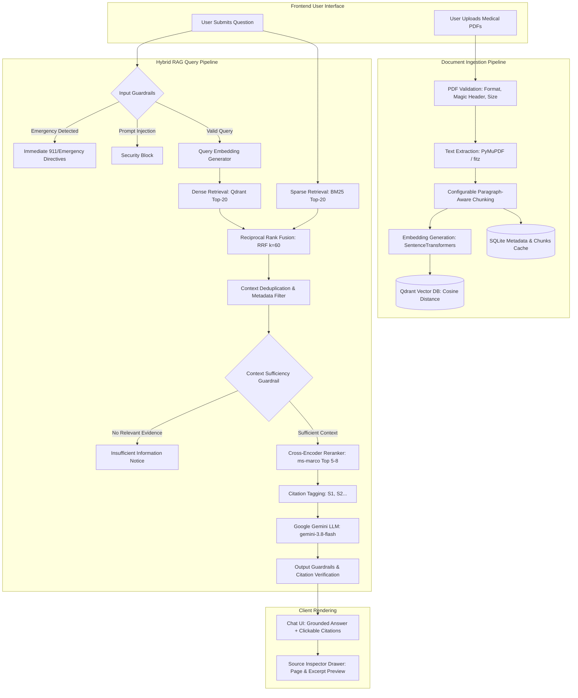

# Medical AI Assistant — System Architecture & Technical Design

## 1. Executive Summary
The **Medical AI Assistant** is an enterprise-grade, document-grounded clinical question-answering system built with **Django**, **Python**, **Qdrant Vector Database**, and the **Google Gemini API**. It adheres to a strict **Hybrid Retrieval-Augmented Generation (Hybrid RAG)** pattern designed specifically for healthcare documents (e.g., patient records, lab reports, discharge summaries, prescriptions).

The system ensures that LLM responses are strictly anchored in uploaded documents, prevents unauthorized medical diagnoses and prescriptions, suppresses prompt injections, and generates verifiable page-level citations.

---

## 2. End-to-End Architectural Flow



---

## 3. Core Subsystems & Component Responsibilities

### Module 1: PDF Ingestion & Validation (`services/pdf_processor.py`)
- **Validation**: Enforces strict security boundaries before reading files:
  - Magic header validation (`%PDF-`) to prevent MIME-spoofing.
  - File size limits (default 20 MB).
  - Detection of encrypted/password-protected PDFs.
  - Identification of scanned/image-only PDFs lacking extractable text, prompting an explicit notice that OCR is required.
- **Deduplication**: Computes SHA-256 hashes of incoming files to prevent redundant ingestion.
- **Traceability**: Extracts text on a per-page basis (1-indexed) using PyMuPDF (`fitz`), preserving page coordinates and document metadata.

### Module 2: Paragraph-Aware Document Chunking (`services/chunking_service.py`)
- **Strategy**: Recursive text splitting with boundary preservation (default: ~800 tokens per chunk with ~150 tokens overlap).
- **Clinical Integrity**: Respects natural paragraph and sentence endings to prevent splitting critical clinical expressions (e.g., medication names, dosage numbers like `500 mg`, and ICD diagnosis codes like `E11.9`).
- **Multi-Page Mapping**: If a chunk spans a page break, both origin pages are retained in `all_pages` so citations link accurately to every relevant page.

### Module 3: Dense Vector Embeddings (`services/embedding_service.py`)
- **Model**: `sentence-transformers/all-MiniLM-L6-v2`.
- **Properties**: 384-dimensional dense semantic vectors with L2 normalization.
- **Singleton Pattern**: Lazy loading ensures the neural model is loaded once into memory and reused across worker requests.

### Module 4: Qdrant Vector Database (`services/qdrant_service.py`)
- **Collection Configuration**: `medical_documents` collection configured with Cosine distance.
- **Payload Schema**:
  ```json
  {
    "document_id": "uuid-string",
    "document_name": "clinical_summary.pdf",
    "chunk_id": "doc_123_chunk_0001",
    "chunk_index": 0,
    "page_number": 3,
    "all_pages": [3],
    "chunk_text": "Extracted medical content...",
    "section_title": "Assessment & Plan",
    "uploaded_at": "2026-10-28T12:00:00"
  }
  ```
- **High Availability Fallback**: Seamlessly connects to remote/Docker Qdrant (`http://localhost:6333`), with automatic fallback to local disk storage (`./qdrant_storage`) if the external container is unavailable.
- **Synchronized Deletion**: Deleting a document in Django triggers a batch deletion of all matching vector points in Qdrant.

### Module 5: Sparse BM25 Keyword Retrieval (`services/sparse_retrieval_service.py`)
- **Purpose**: Complements semantic vector search by matching exact clinical terminology, medication names, dosages, and alphanumeric identifiers.
- **Custom Tokenization**: Employs medical tokenization that preserves hyphens, periods, and dosages (e.g. `500mg`, `10ml`, `q.d.`).
- **Stopword Pruning**: Filters conversational English stopwords ("what", "is", "the", "of") to prioritize high-value clinical keywords.

### Module 6: Reciprocal Rank Fusion (RRF) (`services/hybrid_retrieval_service.py`)
- **Formula**:
  $$\text{RRF}(d) = \sum_{m \in \{\text{dense}, \text{sparse}\}} \frac{1}{k + \text{rank}_m(d)} \quad (k = 60)$$
- **Deduplication**: Unifies dense and sparse candidate lists by `chunk_id`, aggregating rank positions.
- **Metadata Filtering**: Restricts retrieval candidates to the authenticated user's records or an optionally selected document scope.

### Module 7: Cross-Encoder Reranking (`services/reranking_service.py`)
- **Model**: `cross-encoder/ms-marco-MiniLM-L-6-v2`.
- **Mechanism**: Jointly evaluates `(query, chunk_text)` pairs with deep cross-attention, producing a calibrated relevance score.
- **Context Filtering**: Filters the top 30 fused candidates down to the top 5–8 most relevant passages, preventing context window saturation and reducing LLM hallucinations.

### Module 8: Medical LLM Guardrails (`services/guardrails_service.py`)
1. **Input Guardrails**:
   - Rejects empty queries and inputs exceeding 2000 characters.
   - Detects prompt injection attempts (e.g., *"ignore previous instructions"*, *"system override"*, *"DAN"*).
   - Emergency keyword detection: Intercepts acute symptoms (chest pain, stroke, severe bleeding, overdose) and displays immediate directives to contact emergency services (911).
2. **Context Guardrails**:
   - Evaluates retrieved context volume and relevance. If no valid context is found, immediately returns:
     *"The uploaded documents do not contain sufficient information to answer this question."*
3. **Medical Safety Guardrails**:
   - Prohibits independent diagnosis, medication prescribing, and dosage adjustments.
   - Appends a non-diagnostic educational medical disclaimer to every response.
4. **Output Verification**:
   - Cross-checks citation tags (`[S1]`, `[S2]`) against actual retrieved chunks, stripping hallucinated citation references.

### Module 9: Gemini LLM Integration (`services/gemini_service.py`)
- **SDK**: `google-genai` client using `gemini-3.8-flash`.
- **System Prompting**: Separates system instructions from untrusted document content, treating retrieved text strictly as evidence.
- **Offline / Test Mode**: Provides grounded synthesis fallback if running in environments without an active API key.

### Module 10: Verifiable Citation System (`services/citation_service.py`)
- Maps retrieved passages to structured identifiers: `[S1]`, `[S2]`, etc.
- In the frontend UI, citation badges render beneath the answer. Clicking any badge opens a slide-out drawer displaying the document title, exact page number, section name, and highlighted source excerpt.

---

## 4. Security & Privacy Architecture

| Security Domain | Architectural Measure |
|---|---|
| **Document Isolation** | Strict user-level and session-level database filtering. Users can never query or view other users' medical documents. |
| **Untrusted Content** | Uploaded PDF text is treated as untrusted data; embedded injection commands cannot override system instructions. |
| **Credential Protection** | API keys and secrets are loaded exclusively via environment variables (`.env`); never committed to version control or sent to the client. |
| **No Clinical Logging** | Sensitive medical record text and patient findings are excluded from server application logs. |
| **File Access Control** | Documents are served through protected Django views rather than exposed public directory indexes. |

---

## 5. Architectural Failure Modes & Fallbacks

| Scenario | System Behavior |
|---|---|
| **No documents uploaded** | Graceful prompt: *"Please upload at least one PDF document before asking questions."* |
| **Query not in records** | Context guardrail returns: *"The uploaded documents do not contain sufficient information to answer this question."* |
| **Scanned/image-only PDF** | Ingestion catches 0-character extraction and informs user: *"OCR is required for scanned documents."* |
| **Remote Qdrant offline** | Client automatically falls back to local file storage at `./qdrant_storage`. |
| **External Gemini API downtime** | Caught gracefully with safe user notification without exposing stack traces. |
